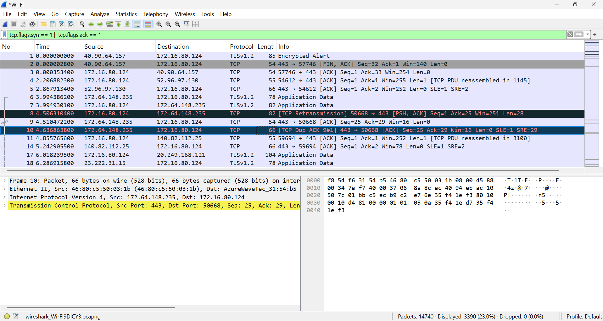
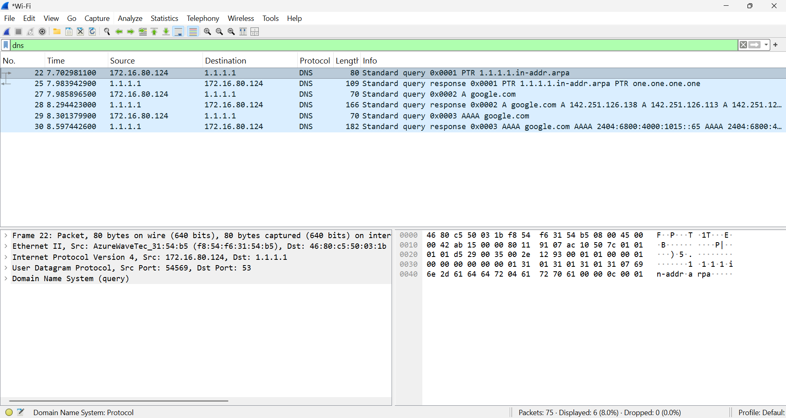
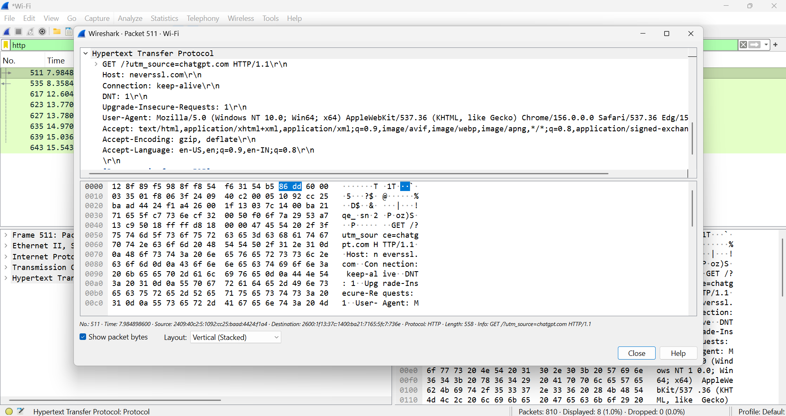
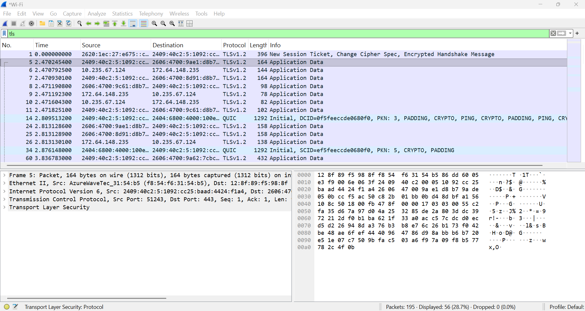
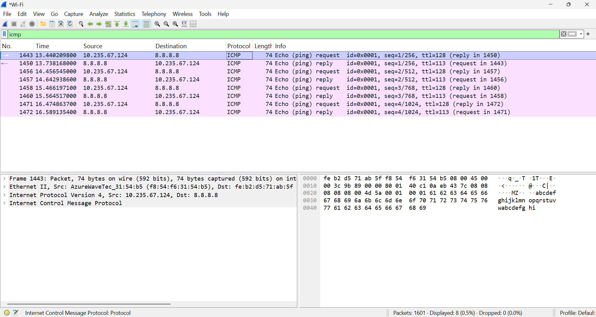
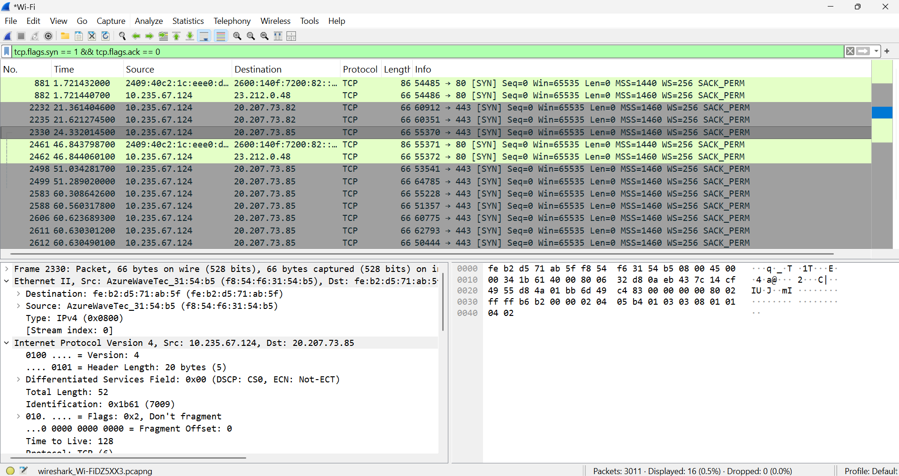

# 🌐 Wireshark Network Traffic Analysis

## 📌 Project Overview

This project focuses on capturing, monitoring, and analyzing network traffic using **Wireshark**, a powerful open-source network protocol analyzer.

The objective is to understand how data travels across a network, inspect network packets, analyze different communication protocols, and identify unusual or suspicious network activities.

## 🎯 Objectives

- Capture live network traffic using Wireshark.
- Analyze network packets and communication.
- Understand TCP/IP protocols.
- Inspect DNS, HTTP, HTTPS, UDP, and ICMP traffic.
- Identify source and destination IP addresses.
- Apply display filters for packet analysis.
- Understand network troubleshooting techniques.

## 🛠️ Tools & Technologies

| Tool / Technology | Purpose |
|---|---|
| Wireshark | Network packet analysis |
| TCP/IP | Network communication |
| DNS | Domain name resolution |
| HTTP/HTTPS | Web communication |
| TCP/UDP | Transport layer protocols |
| ICMP | Network diagnostics |

## 💻 System Requirements

- Operating System: Windows 10 / Windows 11
- Wireshark: Installed
- Internet Connection
- Network Interface: Wi-Fi or Ethernet

## ⚙️ Project Implementation

## 🟢 Step 1: Download and Install Wireshark

Wireshark is a free and open-source network protocol analyzer used to capture and inspect network traffic.

### 📥 1. Download Wireshark

1. Open the official Wireshark download website:

   👉 [Download Wireshark – Official Website](https://www.wireshark.org/download.html)

2. Select the **Windows Installer** option.
3. Wait for the installer to download.

### ⚙️ 2. Install Wireshark

1. Open the downloaded Wireshark installer.
2. Click **Next** to continue.
3. Accept the license agreement.
4. Keep the default installation components.
5. Click **Next** to proceed.

### 🔧 3. Install Npcap

1. During installation, enable the Npcap installation option.
2. Npcap is required to capture live network packets.
3. Follow the installation instructions.
4. Complete the Npcap installation.

### ✅ 4. Complete Installation

1. Click **Next** to finish the installation.
2. Click **Finish**.
3. Open Wireshark from the Windows Start Menu.
4. Verify that the application opens successfully.

## 🟢 Step 2: Open Wireshark and Select Network Interface

After successfully installing Wireshark, open the application and select the active network interface to capture network traffic.

### 1. Open Wireshark

1. Press the **Windows key** on your keyboard.
2. Type `Wireshark` in the search bar.
3. Click the Wireshark application to open it.

### 2. View Available Network Interfaces

After opening Wireshark, you will see the available network interfaces.

Common network interfaces include:

- **Wi-Fi:** Used when connected to a wireless network.
- **Ethernet:** Used when connected through a wired network.

### 3. Select the Active Network Interface

1. Identify the network interface currently connected to the internet.
2. If you are using Wi-Fi, select the **Wi-Fi** interface.
3. If you are using a LAN cable, select the **Ethernet** interface.
4. Double-click the selected interface to start capturing network packets.

### 4. Start Capturing Network Traffic

After selecting the interface:

- Wireshark will start capturing packets.
- You will see network packets appearing in real time.
- Each packet contains information about network communication.


## 🟢 Step 3: Perform Packet Capture

Packet capture is the process of recording network traffic travelling through a selected network interface. Wireshark allows us to capture and inspect these packets in real time.

### 1. Start Packet Capture

1. Open Wireshark.
2. Double-click your active **Wi-Fi** or **Ethernet** network interface.
3. Wireshark will start capturing live network traffic.

### 2. Generate Network Traffic

1. Keep Wireshark running.
2. Open a web browser such as Chrome or Edge.
3. Visit ordinary websites.
4. Browse for approximately 20–30 seconds.
5. Observe the packets appearing in Wireshark.

### 3. Stop Packet Capture

1. Return to the Wireshark window.
2. Click the red **Stop** button at the top.
3. Packet capturing will stop.
4. You can now inspect the captured network packets.

### 4. Save the Captured File

1. Click **File** in the menu bar.
2. Select **Save As**.
3. Choose your project folder.
4. Enter the filename:

   `basic-capture.pcapng`

5. Click **Save**.


## 🟢 Step 4: Analyze TCP Three-Way Handshake

The TCP Three-Way Handshake is a process used to establish a reliable connection between a client and a server before data transmission begins.

### 1. Understand TCP Three-Way Handshake

The TCP handshake consists of three steps:

**1. SYN (Synchronize)**

- The client sends a SYN packet to the server.
- It requests to establish a TCP connection.

**2. SYN-ACK (Synchronize-Acknowledge)**

- The server responds with a SYN-ACK packet.
- It acknowledges the client's request and sends its own synchronization request.

**3. ACK (Acknowledge)**

- The client sends an ACK packet to the server.
- The TCP connection is successfully established.

### TCP Three-Way Handshake Diagram

```text
       CLIENT                         SERVER
          |                              |
          | -------- SYN -------------> |
          |                              |
          | <------ SYN-ACK ------------ |
          |                              |
          | -------- ACK -------------> |
          |                              |
          |                       Connection
          |                        Established
```

### 2. Capture TCP Traffic

1. Open Wireshark.
2. Select your active Wi-Fi or Ethernet interface.
3. Start packet capturing.
4. Open your web browser.
5. Visit a website such as:

   https://example.com

6. Return to Wireshark.
7. Click the red **Stop** button.

### 3. Apply TCP Display Filters

Enter the following filter in the Wireshark display filter bar:

**Filter 1: Display SYN Packets**

```text
tcp.flags.syn == 1
```

This filter displays TCP packets with the SYN flag enabled.

**Filter 2: Display SYN and ACK Packets**

```text
tcp.flags.syn == 1 || tcp.flags.ack == 1
```

This filter displays TCP packets with either the SYN or ACK flag enabled.

### 4. Analyze TCP Handshake Packets

1. Find a TCP connection in the captured packets.
2. Identify the initial SYN packet.
3. Find the corresponding SYN-ACK response.
4. Identify the final ACK packet.
5. Select each packet and expand the **Transmission Control Protocol (TCP)** section in the Packet Details pane.
6. Inspect the TCP Flags field.

| Packet | TCP Flag | Description |
|---|---|---|
| First | SYN | Client requests connection |
| Second | SYN, ACK | Server acknowledges request |
| Third | ACK | Client confirms connection |

**Note:** Match packets using their source/destination IP addresses and TCP port numbers. The combined filter may display unrelated ACK packets too.



### 🎯 Result

Successfully captured and analyzed TCP packets using Wireshark. Identified the SYN, SYN-ACK, and ACK packets and understood how a TCP connection is established between a client and a server.

## 🟢 Step 5: Analyze DNS Traffic

DNS (Domain Name System) is used to translate human-readable domain names into IP addresses that computers use to communicate over a network.

**Example:**

```text
google.com → IP Address
```

### 1. Generate DNS Traffic Using Command Prompt

1. Press `Windows + R`.
2. Type `cmd` and press Enter.
3. Enter the following command:

```bash
nslookup example.com
```

4. Press Enter.
5. Observe the DNS lookup result, including the DNS server and resolved IP address.

### 2. Capture DNS Traffic in Wireshark

1. Open Wireshark.
2. Select your active Wi-Fi or Ethernet interface.
3. Start packet capturing **before running the DNS command again**.
4. Open Command Prompt.
5. Execute the following command:

```bash
nslookup example.com
```

6. Wait for the DNS query and response.
7. Return to Wireshark.
8. Click the red **Stop** button.

### 3. Apply DNS Display Filter

Enter the following filter in the Wireshark display filter bar:

```text
dns
```

Press Enter to display DNS packets.

### 4. Analyze DNS Packets

Select a DNS packet and expand the **Domain Name System (DNS)** section in the Packet Details pane.

Observe the following information:

- **Query Name:** Domain name requested by the client.
- **Query Type:** Type of DNS record requested (A, AAAA, etc.).
- **Response IP Address:** IP address returned by the DNS server.
- **DNS Server:** Server responsible for processing the DNS request.

### 5. Important DNS Display Filters

| Display Filter | Description |
|---|---|
| `dns` | Displays all DNS packets |
| `dns.flags.response == 0` | Displays DNS queries |
| `dns.flags.response == 1` | Displays DNS responses |
| `dns.qry.name == "example.com"` | Filters queries for example.com |
| `dns.a` | Displays DNS A records |



### 🎯 Result

Successfully generated DNS traffic using the `nslookup` command and captured DNS queries and responses using Wireshark. Analyzed domain names, DNS query types, response IP addresses, and DNS server information.

## 🟢 Step 6: Analyze HTTP and HTTPS Traffic

HTTP (Hypertext Transfer Protocol) and HTTPS (Hypertext Transfer Protocol Secure) are communication protocols used to transfer data between web browsers and web servers.

### 📌 Difference Between HTTP and HTTPS

| Feature | HTTP | HTTPS |
|---|---|---|
| Full Form | Hypertext Transfer Protocol | Hypertext Transfer Protocol Secure |
| Default Port | 80 | 443 |
| Security | Not encrypted | Encrypted using TLS |
| Data Transfer | Plaintext (when HTTP is used directly) | Encrypted application data |
| Security Level | Less secure | More secure |

---

### A. HTTP Traffic Analysis

HTTP is used for communication between a browser and a web server. Standard HTTP traffic is generally transmitted without encryption.

#### 1. Start Packet Capture

1. Open Wireshark.
2. Select your active Wi-Fi or Ethernet interface.
3. Start a new packet capture.

#### 2. Generate HTTP Traffic

1. Open your web browser.
2. Visit the following HTTP test website:

   🌐 http://neverssl.com/

3. Wait for the webpage to load.
4. Return to Wireshark.
5. Click the red **Stop** button.

#### 3. Apply HTTP Display Filter

Enter the following filter in the Wireshark display filter bar:

```text
http
```

Press Enter to display HTTP packets.

#### 4. Analyze HTTP Packets

Inspect the following information:

- HTTP Request Method (GET, POST).
- Request URI.
- Hostname.
- HTTP Response Status Code.
- User-Agent.
- HTTP Headers.

If HTTP traffic is visible, select a packet and expand the **Hypertext Transfer Protocol** section in the Packet Details pane.



---

### B. HTTPS Traffic Analysis

HTTPS provides secure communication between browsers and web servers by using TLS encryption.

It protects application data from being read by unauthorized parties during transmission.

#### 1. Start a New Packet Capture

1. Open Wireshark.
2. Select your active network interface.
3. Start a new packet capture.

#### 2. Generate HTTPS Traffic

1. Open your web browser.
2. Visit the following HTTPS website:

   🌐 https://example.com/

3. Wait for the webpage to load.
4. Return to Wireshark.
5. Click the red **Stop** button.

#### 3. Apply HTTPS/TLS Display Filter

Enter the following filter:

```text
tls
```

Press Enter to display TLS packets.

#### 4. Analyze TLS Packets

Inspect the following information:

- TLS Handshake.
- Client Hello.
- Server Hello.
- Certificate information, when visible.
- Encrypted Application Data.
- Source and Destination IP addresses.
- Source and Destination Ports.

You may observe TLS handshake packets and encrypted application traffic.



---

### 📊 HTTP vs HTTPS Packet Analysis

| Analysis | HTTP | HTTPS |
|---|---|---|
| Display Filter | `http` | `tls` |
| Default Port | 80 | 443 |
| Request Details | Generally readable | Encrypted |
| Application Data | Generally visible | Encrypted |
| TLS Handshake | No | Yes |

### 🎯 Result

Successfully captured and analyzed HTTP and HTTPS traffic using Wireshark. Identified HTTP requests and responses, examined TLS handshake packets, and understood how HTTPS protects application data through encryption.

## 🟢 Step 7: Analyze ICMP Traffic

ICMP (Internet Control Message Protocol) is a network-layer protocol used for network diagnostics, error reporting, and connectivity testing.

The `ping` command uses ICMP Echo Request and Echo Reply packets to check whether a destination device is reachable.

### 1. Start Packet Capture

1. Open Wireshark.
2. Select your active Wi-Fi or Ethernet network interface.
3. Click the interface to start capturing network traffic.

### 2. Generate ICMP Traffic Using Command Prompt

1. Press `Windows + R`.
2. Type `cmd` and press Enter.
3. Execute the following command:

```bash
ping -n 4 8.8.8.8
```

4. Press Enter.
5. Windows will send four ICMP Echo Request packets to Google's public DNS server (8.8.8.8).
6. Observe the ping responses in Command Prompt.

### 3. Stop Packet Capture

1. Return to the Wireshark application.
2. Click the red **Stop** button.
3. Your ICMP packet capture will now be available for analysis.

### 4. Apply ICMP Display Filter

Enter the following filter in the Wireshark display filter bar:

```text
icmp
```

Press Enter to display ICMP packets.

### 5. Analyze ICMP Packets

You should see the following ICMP packet types if the network permits them:

**1. Echo Request (Type 8)**

- Sent by the source device.
- Requests a response from the destination device.
- Used to check network connectivity.

**2. Echo Reply (Type 0)**

- Sent by the destination device.
- Responds to the Echo Request.
- Indicates that the destination is reachable.

### 6. ICMP Packet Analysis Table

| ICMP Type | Packet Name | Description |
|---|---|---|
| Type 8 | Echo Request | Request sent to the destination |
| Type 0 | Echo Reply | Response received from the destination |



### 🎯 Result

Successfully generated ICMP traffic using the Windows `ping` command and captured ICMP Echo Request and Echo Reply packets using Wireshark.

## 🟢 Step 8: Analyze FTP Traffic

FTP (File Transfer Protocol) is a standard network protocol used to transfer files between computers over a network.

FTP commonly uses **TCP port 21** for control connections.

### 1. Understand FTP Protocol

FTP is used for:
- Uploading files to a server.
- Downloading files from a server.
- Managing files and directories.
- Communication between FTP clients and servers.

### 2. Open Wireshark

1. Open Wireshark.
2. Open an existing authorized FTP capture file (`.pcap` or `.pcapng`) or start capturing traffic from your own FTP lab server.
3. Make sure the capture contains FTP-related traffic.

### 3. Apply FTP Display Filter

Enter the following filter in the Wireshark display filter bar:

```text
ftp || tcp.port == 21
```

Press Enter to display FTP-related packets and TCP traffic using port 21.

### 4. Analyze FTP Traffic

Inspect the following information:

- **FTP Control Connection:** Communication between the FTP client and server.
- **Client Address:** IP address of the FTP client.
- **Server Address:** IP address of the FTP server.
- **TCP Port 21:** Default FTP control connection port.
- **FTP Commands:** Commands exchanged between client and server, if visible.

### 5. Common FTP Commands

| FTP Command | Description |
|---|---|
| USER | Specifies the username |
| PASS | Sends the password |
| LIST | Lists files and directories |
| RETR | Downloads a file |
| STOR | Uploads a file |
| QUIT | Closes the FTP connection |

**Note:** If an FTP server or authorized FTP capture file is unavailable, mark this activity as **Not Performed**. Do not create or claim screenshots of traffic that you did not capture.

## 🟢 Step 9: Perform Attack Traffic Analysis

Attack Traffic Analysis is the process of examining network packets to identify unusual communication patterns, suspicious activities, and potential network security threats.

In this project, Wireshark is used to investigate possible port scanning, ICMP flooding, and suspicious DNS activity without performing any actual attacks.

### A. Possible Port Scanning Analysis

Port scanning is a technique used to identify open ports and available services on a target system.

#### 1. Apply TCP SYN Filter

Open Wireshark and enter the following display filter:

```text
tcp.flags.syn == 1 && tcp.flags.ack == 0
```

Press Enter to display initial TCP SYN packets.

#### 2. Analyze Suspicious SYN Traffic

Look for the following patterns:

- Multiple TCP connection requests from a single source IP.
- Connection attempts targeting different destination ports.
- Repeated connection attempts within a short period.
- Large numbers of unanswered SYN requests.
- Unusual connection patterns.

#### 3. Port Scanning Indicators

| Indicator | Description |
|---|---|
| Multiple SYN Packets | Repeated connection attempts |
| Multiple Destination Ports | Possible port scanning activity |
| Single Source IP | One source contacting many ports |
| Unanswered SYN Requests | Connections not successfully established |

**Note:** A SYN packet alone does not indicate a port scan. Normal network communication also uses SYN packets.

---

### B. Possible ICMP Flood Analysis

An ICMP flood is a type of Denial-of-Service (DoS) attack in which excessive ICMP packets are sent toward a target system.

#### 1. Apply ICMP Filter

Enter the following display filter:

```text
icmp
```

Press Enter to display ICMP packets.

#### 2. Analyze ICMP Traffic

Look for the following indicators:

- High numbers of ICMP packets within a short period.
- Repeated Echo Request packets.
- Multiple ICMP packets originating from the same source.
- Unusual increases in ICMP traffic.
- Large numbers of requests without corresponding replies.

#### 3. ICMP Traffic Indicators

| Indicator | Description |
|---|---|
| High ICMP Packet Count | Possible abnormal traffic volume |
| Repeated Echo Requests | Frequent connectivity requests |
| Single Source IP | Concentrated traffic from one source |
| Missing Echo Replies | Possible packet loss or filtering |

**Note:** Frequent ICMP packets do not automatically indicate an attack. Network monitoring and diagnostic tools may generate similar traffic.

---

### C. Possible Suspicious DNS Traffic Analysis

DNS traffic analysis helps identify unusual domain name resolution patterns that may indicate suspicious network activity.

#### 1. Apply DNS Filter

Enter the following display filter:

```text
dns
```

Press Enter to display DNS queries and responses.

#### 2. Analyze DNS Traffic

Look for the following suspicious patterns:

- Repeated DNS queries for the same domain.
- Queries for unexpected or unfamiliar domains.
- Unusually long domain names.
- High numbers of DNS requests in a short period.
- Frequent failed DNS lookups.

#### 3. Useful DNS Display Filters

| Display Filter | Description |
|---|---|
| `dns` | Displays DNS traffic |
| `dns.flags.response == 0` | Displays DNS queries |
| `dns.flags.response == 1` | Displays DNS responses |
| `dns.flags.rcode == 3` | Displays NXDOMAIN responses |
| `dns.qry.name` | Displays packets containing DNS query names |

#### 4. Suspicious DNS Indicators

| Indicator | Description |
|---|---|
| Repeated DNS Queries | Possible automated communication |
| Unusual Domain Names | Potential suspicious destinations |
| Long Domain Names | Possible encoded data or unusual applications |
| High DNS Request Volume | Possible automated DNS activity |
| Multiple NXDOMAIN Responses | Repeated queries for nonexistent domains |

**Note:** These patterns are indicators for further investigation and do not independently prove malicious activity.

---

### D. Analyze Network Traffic Statistics

Wireshark provides statistical tools to investigate traffic patterns.

#### 1. Protocol Hierarchy

Navigate to:

`Statistics → Protocol Hierarchy`

This displays the distribution of protocols in the captured traffic.

#### 2. Conversations

Navigate to:

`Statistics → Conversations`

This displays communication between network endpoints.

#### 3. I/O Graphs

Navigate to:

`Statistics → I/O Graphs`

This helps visualize network traffic volume over time and identify unusual spikes.



### 🎯 Result

Examined captured network traffic using Wireshark display filters to investigate possible port scanning, abnormal ICMP activity, and suspicious DNS communication patterns.

The analysis focused on recognizing potential security indicators without launching attacks.

**Important:** If no suspicious activity is observed, document the result as **No Suspicious Traffic Observed** rather than claiming an attack was detected.
