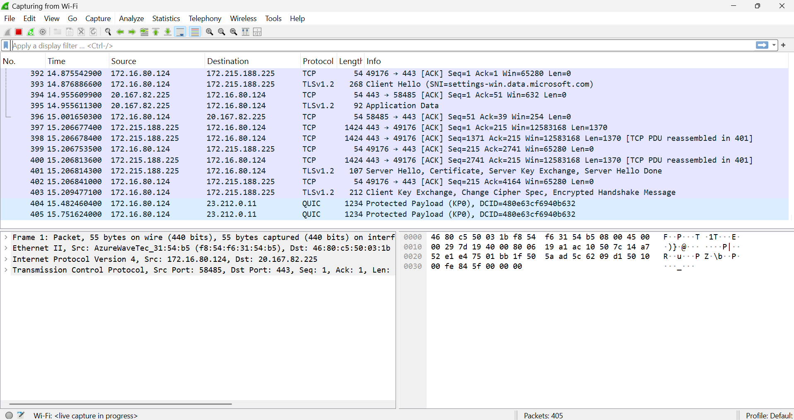
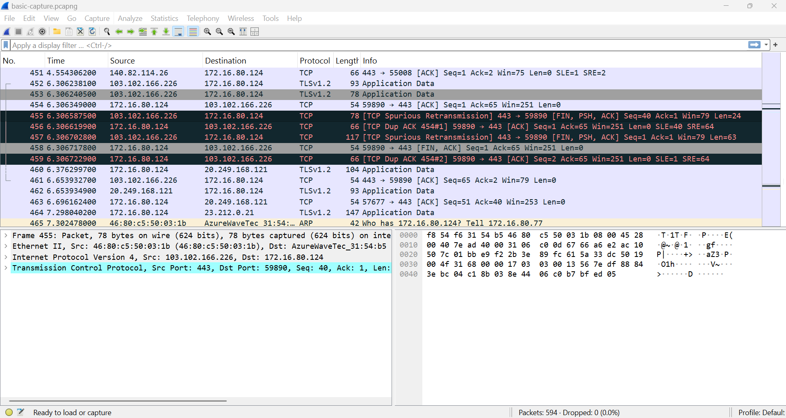

# 🌐 Wireshark Network Traffic Analysis

## 📌 Project Overview

This project focuses on capturing, monitoring, and analyzing network traffic using **Wireshark**, a powerful open-source network protocol analyzer.

The objective is to understand how data travels across a network, inspect network packets, analyze different communication protocols, and identify unusual or suspicious network activities.

## 🎯 Objectives

- Capture live network traffic using Wireshark.
- Analyze network packets and communication.
- Understand TCP/IP protocols.
- Inspect DNS, HTTP, HTTPS, UDP, and ICMP traffic.
- Identify source and destination IP addresses.
- Apply display filters for packet analysis.
- Understand network troubleshooting techniques.

## 🛠️ Tools & Technologies

| Tool / Technology | Purpose |
|---|---|
| Wireshark | Network packet analysis |
| TCP/IP | Network communication |
| DNS | Domain name resolution |
| HTTP/HTTPS | Web communication |
| TCP/UDP | Transport layer protocols |
| ICMP | Network diagnostics |

## 💻 System Requirements

- Operating System: Windows 10 / Windows 11
- Wireshark: Installed
- Internet Connection
- Network Interface: Wi-Fi or Ethernet

## ⚙️ Project Implementation

## 🟢 Step 1: Download and Install Wireshark

Wireshark is a free and open-source network protocol analyzer used to capture and inspect network traffic.

### 📥 1. Download Wireshark

1. Open the official Wireshark download website:

   👉 [Download Wireshark – Official Website](https://www.wireshark.org/download.html)

2. Select the **Windows Installer** option.
3. Wait for the installer to download.

### ⚙️ 2. Install Wireshark

1. Open the downloaded Wireshark installer.
2. Click **Next** to continue.
3. Accept the license agreement.
4. Keep the default installation components.
5. Click **Next** to proceed.

### 🔧 3. Install Npcap

1. During installation, enable the Npcap installation option.
2. Npcap is required to capture live network packets.
3. Follow the installation instructions.
4. Complete the Npcap installation.

### ✅ 4. Complete Installation

1. Click **Next** to finish the installation.
2. Click **Finish**.
3. Open Wireshark from the Windows Start Menu.
4. Verify that the application opens successfully.

## 🟢 Step 2: Open Wireshark and Select Network Interface

After successfully installing Wireshark, open the application and select the active network interface to capture network traffic.

### 1. Open Wireshark

1. Press the **Windows key** on your keyboard.
2. Type `Wireshark` in the search bar.
3. Click the Wireshark application to open it.

### 2. View Available Network Interfaces

After opening Wireshark, you will see the available network interfaces.

Common network interfaces include:

- **Wi-Fi:** Used when connected to a wireless network.
- **Ethernet:** Used when connected through a wired network.

### 3. Select the Active Network Interface

1. Identify the network interface currently connected to the internet.
2. If you are using Wi-Fi, select the **Wi-Fi** interface.
3. If you are using a LAN cable, select the **Ethernet** interface.
4. Double-click the selected interface to start capturing network packets.

### 4. Start Capturing Network Traffic

After selecting the interface:

- Wireshark will start capturing packets.
- You will see network packets appearing in real time.
- Each packet contains information about network communication.

## 🟢 Step 3: Perform Packet Capture

Packet capture is the process of recording network traffic travelling through a selected network interface. Wireshark allows us to capture and inspect these packets in real time.

### 1. Start Packet Capture

1. Open Wireshark.
2. Double-click your active **Wi-Fi** or **Ethernet** network interface.
3. Wireshark will start capturing live network traffic.

### 2. Generate Network Traffic

1. Keep Wireshark running.
2. Open a web browser such as Chrome or Edge.
3. Visit ordinary websites.
4. Browse for approximately 20–30 seconds.
5. Observe the packets appearing in Wireshark.

### 3. Stop Packet Capture

1. Return to the Wireshark window.
2. Click the red **Stop** button at the top.
3. Packet capturing will stop.
4. You can now inspect the captured network packets.

### 4. Save the Captured File

1. Click **File** in the menu bar.
2. Select **Save As**.
3. Choose your project folder.
4. Enter the filename:

   `basic-capture.pcapng`

5. Click **Save**.

